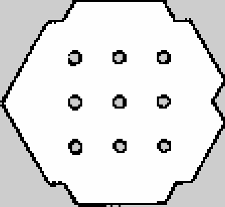

# 04 SLAM 建图

> 开着小车在场景里转一圈，slam_toolbox 一边修正小车的位置、一边画出地图；最后把地图存成文件，05 课的 Nav2 导航就用它。

## 学习目标

- 理解为什么需要 SLAM：只靠里程计，误差会一直累积（03 课实测绕一个方块就差了 0.5 m）
- 理解 `map → odom → base_footprint` 三个坐标系的分工，以及 SLAM 发布的是哪一段
- 了解 slam_toolbox 的原理：扫描匹配、关键帧、位姿图、回环检测
- 看懂占用栅格地图：格子的取值、`.pgm` + `.yaml` 文件格式
- 会用生命周期节点（lifecycle node）和 Transient Local QoS
- 会用键盘遥控或自动漫游建图，并保存地图

## 前置条件

- 已完成的课程：[02 避障漫游](../02_obstacle_avoidance/)（自动探索复用它的避障节点）、
  [03 到点导航](../03_go_to_goal/)（里程计误差）
- 需要额外安装的软件包：`slam_toolbox`、`turtlebot3_teleop`、`nav2_map_server`（对比用），
  一键安装脚本已经装好
- 编译：

```bash
cd ~/ros2_ws
colcon build --symlink-install --packages-up-to pg_slam_py
source install/setup.bash
```

## 知识点

### 1. 为什么需要 SLAM

03 课的 Bug2 只用里程计（`/odom`）知道自己在哪。里程计靠轮子转了多少圈推算位置，
打滑、转向时的误差会**一直累积，永远不会自己消失**。03 课实测：绕方块一圈后，里程计和真实位置差了约 0.5 m。

SLAM（Simultaneous Localization And Mapping，同时定位与建图）用雷达看到的环境来修正位置：
已经画好的那部分地图就是参照物，新的一帧雷达和地图对得上，就说明位置是对的；对不上，就挪一挪直到对上。
位置准了，画出来的地图才准，所以"定位"和"建图"必须同时做。

### 2. 三个坐标系

```
map ──────────→ odom ──────────→ base_footprint
     SLAM 发布          里程计发布（仿真插件）
     会跳变、不漂移      连续平滑、会漂移
```

| 坐标系 | 含义 | 特点 |
|---|---|---|
| `map` | 地图坐标系，原点是开始建图时小车的位置 | 全局准确，但修正时会突然跳一下 |
| `odom` | 里程计坐标系 | 短时间内平滑连续，长时间会漂移 |
| `base_footprint` | 车体在地面上的投影 | 跟着车走 |

SLAM 不直接发布 `map → base_footprint`，而是发布 `map → odom` 这一段"修正量"：
TF 规定每个坐标系只能有一个父坐标系，`odom → base_footprint` 已经由里程计发布了。
需要平滑运动的控制器（例如 03 课）用 `odom`；需要全局位置的导航（05 课）用 `map`。约定见 REP-105。

### 3. slam_toolbox 怎么工作

```
新的一帧雷达 ──→ 扫描匹配：和附近的已有扫描对齐，修正里程计给出的位姿
                    │
                    ├─ 移动超过 minimum_travel_distance 或转过 minimum_travel_heading
                    │   → 加入一个关键帧（位姿图的节点）
                    │
                    └─ 回环检测：当前位置附近有很久以前的关键帧吗？对得上就加一条约束
                        → 优化整个位姿图，把累积误差均摊到一路上的所有关键帧
                                │
                                └─ 每 map_update_interval 秒，用所有关键帧的扫描重新画一次地图
```

- **扫描匹配**（前端）只能减小误差，消除不了：每一步对齐都有一点点误差，走得越远累积越多
- **回环检测**（后端）才能消除累积误差：回到起点附近时，"现在看到的"和"一开始看到的"一对比，就知道一路上偏了多少

所以建图时**要回到走过的地方**，尤其是绕一圈回到起点，让回环检测有机会触发。
RViz 里的位姿图（PoseGraph）显示每个关键帧和它们之间的约束，回环那一刻能看到整张图被"拉"了一下。

### 4. 占用栅格地图

SLAM 发布的地图是 `nav_msgs/msg/OccupancyGrid`：一张 `width × height` 的格子表，每格 0.05 m × 0.05 m。

| 格子的值 | 含义 | 存成图片 |
|---|---|---|
| `-1` | 未知（雷达从没扫到过） | 灰 205 |
| `0` | 空闲 | 白 254 |
| `100` | 障碍 | 黑 0 |

存成文件是 ROS 通用的两件套，Nav2 的 `map_server` 直接读：

```yaml
# tb3_world.yaml
image: tb3_world.pgm            # 灰度图，每格一个像素
mode: trinary                   # 三值：空闲 / 障碍 / 未知
resolution: 0.050               # m/像素
origin: [-0.959, -2.081, 0.000] # 图片左下角像素在 map 坐标系中的位置 (x, y, yaw)
negate: 0                       # 1 表示黑白反转
occupied_thresh: 0.65           # 读图时：暗度 > 0.65 算障碍
free_thresh: 0.196              # 读图时：暗度 < 0.196 算空闲
```

两个容易搞错的地方（`map_io.py` 里有详细注释）：

1. **行的顺序**：`OccupancyGrid` 的第 0 行在地图**最下面**，图片的第 0 行在**最上面**，写图片要上下翻转
2. **原点**是左下角格子的**角**，不是地图中心，也不是小车的出生点

### 5. 生命周期节点

slam_toolbox 是生命周期节点（lifecycle node），启动后不会马上工作，要依次切换状态：

```
unconfigured ──configure──→ inactive ──activate──→ active（开始建图）
                               ↑                    │
                               └────deactivate──────┘
```

好处是启动顺序可控：例如先把所有节点都"配置"好，确认没问题再一起"激活"。
Nav2 的所有核心节点都是生命周期节点，05 课会大量用到。本课的 launch 直接引入了 slam_toolbox 自带的
`online_async_launch.py`，它会自动完成 configure 和 activate。

```bash
ros2 lifecycle get /slam_toolbox          # 当前状态：active [3]
ros2 lifecycle list /slam_toolbox         # 当前状态下可以做哪些切换
```

### 6. Transient Local：后来的订阅者也能收到

地图比较大（这一课的小场景就有一万多格，场景越大格子越多），也不是每帧都变。slam_toolbox 用 **Transient Local** 发布 `/map`：
发布者保留最后一条消息，新的订阅者一连上就能收到，不用等下一次更新。

订阅端也必须声明 Transient Local，否则只能收到连上之后新发布的消息。`map_saver_node.py` 里的 `MAP_QOS`
和 RViz 配置里 Map 显示的 `Durability Policy: Transient Local` 都是为了这个。
同样的机制也用在 `/robot_description` 上（02 课的 RViz 配置）。

### 7. 两种探索方式

| 方式 | 启动 | 优点 | 缺点 |
|---|---|---|---|
| 键盘遥控 | `explore:=teleop`（默认），另开终端运行 `teleop_keyboard` | 可以有意识地绕圈、回到起点触发回环；能钻进角落 | 要一直手动开 |
| 自动漫游 | `explore:=auto`，复用 02 课的避障节点 | 不用管 | 随机游走，可能很久都不去某个角落；回环全靠运气 |

建图的技巧：**慢**（扫描匹配更准）、**少原地快速转圈**（雷达一帧内车在转，扫描会变形）、**回到起点**（触发回环）。

### 8. 代码结构

```
map_io.py            地图 ↔ PGM/YAML、地图统计       纯 Python → 单元测试
map_saver_node.py    收一张 /map 并保存              作用同 nav2 的 map_saver_cli
launch/slam_sim.launch.py   仿真 + slam_toolbox +（可选）自动漫游 + RViz
config/slam.yaml     slam_toolbox 的完整参数，改过的地方标【改】
```

## 一键运行

```bash
# 终端 A：仿真 + SLAM + RViz
ros2 launch pg_slam_py slam_sim.launch.py
# 终端 B：键盘遥控（w/x 加减速，a/d 转向，s 停车）
ros2 run turtlebot3_teleop teleop_keyboard
# 建完图后，终端 C：保存地图
ros2 run pg_slam_py save_map ~/maps/my_map
```

不想手动开车：

```bash
ros2 launch pg_slam_py slam_sim.launch.py explore:=auto
```

预期效果：RViz 中地图从小车周围一圈开始，随着小车移动逐渐扩大；白色是空闲区域，黑色是障碍物，
灰色是还没扫到的地方。turtlebot3_world 是一个六边形围墙，中间 3 × 3 排列着 9 根柱子。

本仓库已经存好一张建好的地图：[`common/pg_sim/maps/tb3_world.yaml`](../../common/pg_sim/maps/)，05 课直接使用：



白色空闲、黑色障碍、灰色未知（围墙外面雷达扫不到）。地图坐标系的原点是建图开始时小车的位置，
即 Gazebo 里的出生点 (-2.0, -0.5)，在图中左侧中间偏下的位置。

## 实验步骤

### 实验 1：键盘遥控建图

```bash
ros2 launch pg_slam_py slam_sim.launch.py
ros2 run turtlebot3_teleop teleop_keyboard
```

1. 先原地慢慢转一圈，看地图一下子能画出多大（雷达量程 3.5 m）
2. 沿着围墙开一圈回到起点，同时观察 RViz 的 PoseGraph：回到起点附近时有没有出现新的连线（回环）
3. 再到柱子之间穿行，把灰色区域补完

**思考**：为什么柱子的背面一开始是灰色的？

### 实验 2：自动漫游建图

```bash
ros2 launch pg_slam_py slam_sim.launch.py explore:=auto
ros2 run pg_slam_py save_map --stats-only     # 隔几分钟运行一次，看空闲面积的增长
```

记录"已知比例"和空闲面积随时间的变化。和实验 1 比，建完整张图需要多久？

### 实验 3：观察 SLAM 的修正量

```bash
ros2 run tf2_ros tf2_echo map odom
```

`map → odom` 就是 SLAM 对里程计的修正。刚启动时接近 0；开得越久，它越大。
开到柱子旁边贴着转几圈（容易打滑），再看它的变化。

### 实验 4：保存地图，和 Nav2 的工具对比

```bash
ros2 run pg_slam_py save_map /tmp/mine
ros2 run nav2_map_server map_saver_cli -f /tmp/nav2
cmp /tmp/mine.pgm /tmp/nav2.pgm && echo 一致
diff /tmp/mine.yaml /tmp/nav2.yaml
```

先让小车停下（Ctrl+C 键盘遥控，或者关掉避障节点），否则两次保存之间地图可能更新了。
`.pgm` 可以用任何看图软件打开（在 Windows 里打开 `\\wsl.localhost\Ubuntu-24.04\tmp\mine.pgm`）。

再试试改阈值：`--free-thresh 0.5`，统计里的空闲格子数变了吗？（slam_toolbox 只输出 -1、0、100，所以不会变；
换成输出概率的 SLAM 算法时阈值才有影响。）

### 实验 5：调参

修改 `config/slam.yaml` 后重新 launch：

| 参数 | 改成 | 观察 |
|---|---|---|
| `resolution` | 0.1 | 地图更粗糙，文件更小；柱子还是圆的吗？ |
| `max_laser_range` | 1.5 | 每次只画近处，要开更多路才能建完 |
| `minimum_travel_distance` | 1.5 | 关键帧很稀，转弯处地图容易错位 |
| `do_loop_closing` | false | 绕一圈回到起点时，墙会不会画出"双影"？ |

### 实验 6：生命周期

```bash
ros2 lifecycle set /slam_toolbox deactivate    # 停用
ros2 lifecycle get /slam_toolbox               # inactive [2]
ros2 lifecycle set /slam_toolbox activate      # 恢复
```

停用期间开车，观察：RViz 里的地图还会长吗？`ros2 run tf2_ros tf2_echo map odom` 的输出有什么变化？
恢复之后，停用期间走过的地方会补画上吗？

### 实验 7：换个场景

```bash
ros2 launch pg_slam_py slam_sim.launch.py world:=house
```

house 场景有多个房间和门，自动漫游很难钻进每个房间，试试键盘遥控。

## 代码导读

| 文件 | 作用 |
|---|---|
| [`map_io.py`](pg_slam_py/pg_slam_py/map_io.py) | 地图 → PGM/YAML、统计、PGM 解析（本课核心） |
| [`map_saver_node.py`](pg_slam_py/pg_slam_py/map_saver_node.py) | 地图保存工具 `save_map` |
| [`launch/slam_sim.launch.py`](pg_slam_py/launch/slam_sim.launch.py) | 仿真 + SLAM + 两种探索方式 |
| [`config/slam.yaml`](pg_slam_py/config/slam.yaml) | slam_toolbox 参数，逐项注释 |
| [`rviz/slam.rviz`](pg_slam_py/rviz/slam.rviz) | 地图、雷达、位姿图、TF |
| [`test/test_map_io.py`](pg_slam_py/test/test_map_io.py) | 单元测试：灰度转换、上下翻转、文件格式 |

建议阅读顺序：`config/slam.yaml`（了解 SLAM 有哪些旋钮）→ `launch/slam_sim.launch.py` →
`map_io.py` → `test/test_map_io.py` → `map_saver_node.py`。

按提交记录学习：`git log --oneline -- lessons/04_slam_mapping common/pg_sim/maps`。

## 实验记录

环境：WSL2 + Gazebo Harmonic，无窗口模式，turtlebot3_world 场景，默认出生点 (-2.0, -0.5)。

| 日期 | 实验 | 参数 | 现象 | 结论 |
|---|---|---|---|---|
| 2026-11-24 | 单元测试 | `colcon test --packages-select pg_slam_py` | `test_map_io.py` 全部通过（含 flake8、pep257） | 地图格式可以离线验证 |
| 2026-11-24 | 启动 | `explore:=auto` | `ros2 lifecycle get /slam_toolbox` 为 `active [3]`；`map → odom` 平移约 2 cm | 官方 launch 自动完成 configure / activate |
| 2026-11-24 | 自动漫游建图 | 默认参数 | 空闲面积（仿真时间）：13 s 13.9 m²，25 s 18.1 m²，43 s 19.3 m²，53 s 19.6 m²，之后不再增长 | 这个小场景不到 1 分钟就基本建完，之后只是补细节（障碍格从 699 增加到 787） |
| 2026-11-24 | 地图质量 | 漫游约 160 s 仿真时间 | 112 × 103 格（5.60 × 5.15 m），六边形围墙和 9 根柱子完整，无重影；已知比例 74.7%（其余是围墙外） | 存为 `pg_sim/maps/tb3_world`，05 课使用 |
| 2026-11-24 | 两种保存工具对比 | 停车后先 `map_saver_cli` 再 `save_map` | `.pgm` 逐字节一致；`.yaml` 只差图片文件名、yaw 的写法（`0` 与 `0.000`）和末尾换行 | 自己写的工具与 Nav2 等价 |
| 2026-11-24 | 地图原点 | — | `origin: [-0.959, -2.081, 0.000]` | 原点是左下角格子的角，不是出生点（出生点是 map 坐标系的 (0, 0)） |

## 课后练习

1. **探索进度**：写一个节点订阅 `/map`，每 10 秒打印一次已知比例，比较键盘遥控和自动漫游的建图速度曲线。
2. **前沿探索**：自动漫游是随机走的。找出地图上"空闲格子挨着未知格子"的位置（前沿，frontier），
   用 03 课的 `navigate_to_point` 动作开过去，实现真正有目的的自动建图。
3. **继续建图**：用 `ros2 service call /slam_toolbox/serialize_map` 保存位姿图，下次用
   `deserialize_map` 接着建，而不是从头开始。
4. **地图编辑**：用看图软件在 `.pgm` 上画一道黑线（"虚拟墙"），05 课导航时机器人会绕开它吗？

## 常见问题

**问题**：RViz 提示 `Frame [map] does not exist`
**解决**：slam_toolbox 还没激活。等几秒；或者 `ros2 lifecycle get /slam_toolbox` 看状态是不是 `active`。

**问题**：`save_map` 提示"没有收到 map"
**解决**：确认 SLAM 在运行：`ros2 topic info /map -v` 应能看到发布者，且 Durability 为 `TRANSIENT_LOCAL`。

**问题**：`teleop_keyboard` 报 `KeyError: 'TURTLEBOT3_MODEL'`
**解决**：`export TURTLEBOT3_MODEL=waffle`（一键安装脚本已写入 `~/.bashrc`，新开终端即可）。

**问题**：地图上墙壁有重影、错位
**解决**：开得太快或原地转得太快。慢一点，并回到起点附近让回环检测修正；必要时调小 `minimum_travel_distance`，让关键帧更密。

**问题**：自动漫游很久都不去某个角落
**解决**：随机游走的通病。用键盘遥控补完，或者做课后练习 2（前沿探索）。

## 参考资料

- [slam_toolbox 项目主页与参数说明](https://github.com/SteveMacenski/slam_toolbox)
- [Macenski & Jambrecic, SLAM Toolbox: SLAM for the dynamic world（JOSS 2021）](https://joss.theoj.org/papers/10.21105/joss.02783)
- [REP-105：机器人坐标系约定（map、odom、base_link）](https://www.ros.org/reps/rep-0105.html)
- [nav_msgs/msg/OccupancyGrid 定义](https://docs.ros.org/en/jazzy/p/nav_msgs/msg/OccupancyGrid.html)
- [Nav2 map_server 地图文件格式](https://docs.nav2.org/configuration/packages/configuring-map-server.html)
- [生命周期节点设计文档](https://design.ros2.org/articles/node_lifecycle.html)
- [ROS 2 QoS 概念（Durability）](https://docs.ros.org/en/jazzy/Concepts/Intermediate/About-Quality-of-Service-Settings.html)
